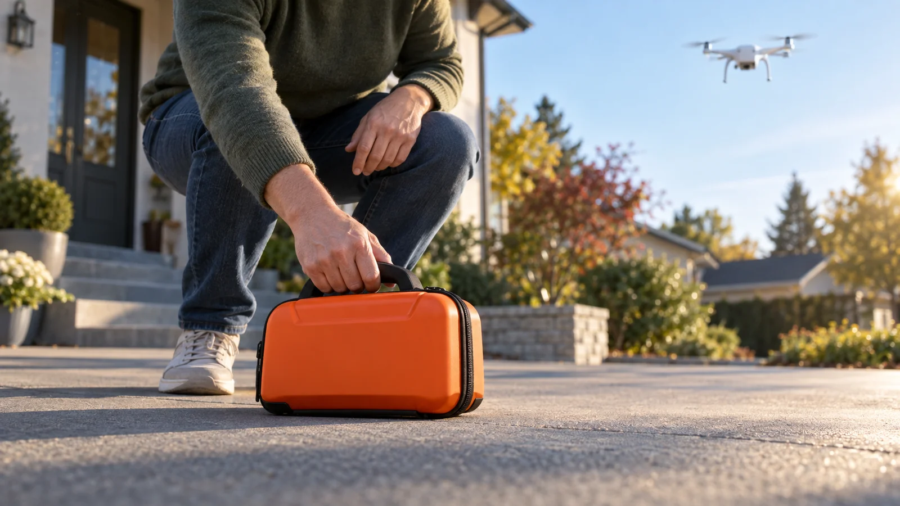
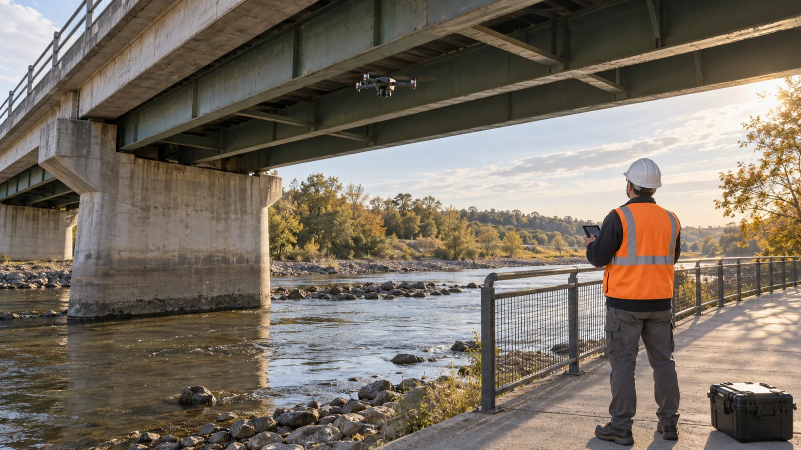

# The Drone You’re Worried About Might Be Bringing Help

**Local draft · Next-post candidate · Not scheduled or published**

## Reader promise

Understand five practical civilian drone benefits, the evidence behind them, and the standards that make useful flights worth trusting.

## Excerpt

Drones can deliver urgent medical supplies, help find missing hikers, and keep inspectors out of dangerous places. Here is the evidence—and what responsible use still has to earn.

## Metadata

- Slug: `drones-bringing-help`
- Author: Colin Michaels, Applications Developer (`colin-michaels`)
- Categories: Drones & FPV; Creative Technology; Opinion
- Tags: Drones, FPV, Medical Delivery, Search and Rescue, Drone Safety, Infrastructure Inspections, Wildfire Response, Privacy
- SEO title: How Drones Help: Rescues, Medical Deliveries and Safer Work
- SEO description: Drones can deliver urgent medical supplies, help find missing hikers, and keep inspectors out of dangerous places. Here is the evidence—and what responsible use still has to earn.
- Intended canonical: https://colinmichaels.com/blog/drones-bringing-help (not live)
- Research checked: September 8, 2026
- Status: draft; publishedAt: null

## Engagement plan

The hook is a familiar worry followed by a concrete useful mission. The arrival-time result provides early proof. Five examples build toward a practical accountability checklist. The single primary action is the community-priority poll; saves and shares are possible benefits, not additional calls to action. No audience-performance ranking is claimed.

## Rich media map

See [the pre-draft editorial plan](editorial-plan.md). The canonical import includes a lead, a quick summary, a sourced stats module, two explanatory inline images, a practical checklist, a takeaway, and one poll. An official rescue report links to its footage; video playback was not verified, so no embed is included.

---

# Blog draft

> A drone can carry a camera into someone’s private space. It can also carry a defibrillator to someone who needs help. What we ask it to do matters.

I fly FPV, so I’m already inclined to see possibility when I hear a set of propellers. I also understand why somebody else hears the same sound and thinks about surveillance, reckless flying, or a machine falling out of the sky. Those concerns deserve answers.

But I want more room in that conversation for the useful flights: equipment getting to a patient, a search team finding someone in the dark, an inspector getting a closer look without having to climb into the same position as the camera. I researched the programs below; I have not operated their emergency or inspection systems.

The benefits become much more interesting when we stop at a real example long enough to ask what improved, who still had to do the work, and where the machine reached its limits.

- Medical-delivery studies have measured earlier arrivals and better supply logistics in specific settings.
- A recent Australian search shows how a drone can help a ground team find missing people.
- Bridge inspections and coordinated fire operations give cameras useful jobs in difficult places.
- Useful missions still need accountable operators, privacy limits, and a plan for conditions in which the aircraft cannot fly.

## Getting a defibrillator there sooner

A Swedish observational study published in 2023 compared drone-delivered automated external defibrillators, or AEDs, with ambulance arrival. Across 211 suspected cardiac-arrest alerts, drones were deployed 72 times and completed 58 deliveries. Both arrival times were available in 55 cases. In 37 of those, the AED arrived first. [Read the original study.](https://pubmed.ncbi.nlm.nih.gov/38000871/)

**The arrival-time result**

Swedish study, April 2021–May 2022. These are delivery comparisons, not survival rates.

| Measure | Result | Scope |
| --- | --- | --- |
| Earlier AED arrival | 37 of 55 | Cases with both arrival times available |
| Median lead | 3 min 14 sec | Among deliveries that beat ambulance arrival |

The 67% result applies to that comparison group, not every emergency call. Weather and operating exclusions limited deployment. Earlier delivery also needs to become actual use: among 18 confirmed arrests in the drone-first group, six patients had the delivered AED attached before the ambulance arrived. [The full paper explains the results and exclusions.](https://www.vgregion.se/contentassets/74ed4a24d73c4f648bcc87aa22721539/schierbeck-et-al-the-lancet-dh-aed-drones-231123.pdf)

That is a promising delivery result, not proof of a population-wide survival improvement. The part that holds my attention is the possibility of making a useful piece of equipment available while professional help is still on its way. The aircraft remains one link in a response that depends on dispatchers, people at the scene, and medical crews.

*AI-generated editorial illustration. Delivery is only one step; someone still has to retrieve and use the equipment. This does not depict the Swedish study or its aircraft.*

## Moving blood supplies around a difficult road network

A 2022 study examined blood deliveries to 20 health facilities in Rwanda. It covered 12,733 drone-delivered orders from 2017 through 2019, including 5,517 emergency orders. Average drone delivery took 49.6 minutes—79 minutes less than one estimate of road delivery time and 98 minutes less than a Google Maps estimate. [The research is published in The Lancet Global Health.](https://pubmed.ncbi.nlm.nih.gov/35303465/)

Those road journeys were estimated, not a fleet of vans racing drones on the same trips. The retrospective analysis also found a reduction in blood-unit expirations after drone delivery began. That is evidence of a useful logistics system in that setting; it does not establish that every drone delivery service is cheaper, greener, or better for patients everywhere.

What I like about this example is how ordinary the problem is: something needed in one place is sitting somewhere else. The achievement is getting supplies through a difficult delivery network. Nobody waiting for them needs the flight to look impressive.

## Helping a search team find the people it is looking for

In June 2026, Fire and Rescue NSW reported that its drone crew helped locate two overdue hikers in the Snowy Mountains. According to the agency, software flagged the pair, thermal imaging helped confirm the location, and the hikers also signaled with a red phone light. The operator used a spotlight to guide the ground team. [Read the rescue agency’s account and its linked footage.](https://www.fire.nsw.gov.au/media/news/2026/20260625-fire-and-rescue-nsw-drone-team-locates-missing-hikers-using-ai-technology)

This is one agency-reported rescue, not an accuracy score for every thermal camera or AI detector. It is also a good reminder to give the people credit: police and rescue crews organized the search, an operator interpreted the information, the hikers signaled, and a ground team brought them to safety.

A camera becomes a very different proposition when it is helping a team locate someone they have been asked to find. That purpose should be specific and limited. A successful rescue does not settle every question about routine aerial surveillance.

## Putting the camera under the bridge

The Federal Highway Administration says drones can supplement bridge inspections and may reduce time spent using access equipment or working beside live traffic. It is equally clear that imagery cannot cover every inspection task: an inspector may still need to touch, sound, or hammer a bridge member to assess it. [See FHWA’s bridge-inspection guidance, question Q313-2.](https://www.fhwa.dot.gov/bridge/nbis2022/qanda/08.cfm)

This is the kind of benefit I would happily put on a very boring brochure. Get a useful view, help the expert decide where to investigate, and reduce some of the difficult access work. An aircraft does not need to replace a job to make part of that job safer or easier.

*AI-generated editorial illustration. A drone can help reach a viewing angle while the inspector stays on the ground; required hands-on checks still matter.*

## Giving fire crews useful information

The U.S. interagency UAS program describes drones supporting incident decisions with imagery and data. Its mission guidance includes mapping and situational awareness, with trained personnel coordinating flights with incident aviation. [The interagency program](https://uas.nifc.gov/) and [its flight-crew briefing](https://uas.nifc.gov/sites/default/files/sites/default/files/inline-files/UAS%20Info%20for%20Flight%20Crews.pdf) describe that organized role.

That coordination is essential. An unauthorized drone near a wildfire can force firefighting aircraft to stop operating. The Department of the Interior repeated that warning in May 2026. If we want drones to help emergency crews, giving those crews clear airspace is part of the deal. [Read the public wildfire warning.](https://www.doi.gov/wildlandfireservice/no-drone-zone-near-wildfires)

Owning a flying camera does not automatically make me part of a response team. The useful mission belongs inside a trained operation with permission, communication, and a defined job.

## There is value in the quieter flights, too

As an FPV pilot, I care about the creative side: learning a skill, making a film, and seeing a familiar place from a new angle. Those are worthwhile reasons to fly responsibly. A drone does not have to be delivering emergency equipment to justify its existence.

I do not get a free pass because I enjoy it, either. Somebody else’s privacy, peace, or safety cannot become the hidden cost of my interesting shot. Enthusiasm should make me more interested in good flying, not less interested in the people underneath it.

## The questions I would ask before welcoming a drone service

Weaponization, intrusive recording, noise, crashes, and disrupted airspace are not imaginary concerns. A list of positive uses does not erase them. For me, the evidence above makes a case for evaluating the actual mission carefully instead of assuming the sound of propellers tells us everything.

- **What specific job is it doing?** Name the problem and the people meant to benefit.
- **What improves compared with the practical alternative?** Ask for measured delivery times, useful findings, or reduced exposure—not just a demonstration video.
- **What does it record, who can see it, and when is it deleted?** A helpful purpose should not become unlimited permission to keep watching.
- **When does it stay on the ground?** Ask about weather, flight limits, other aircraft, and the backup when it cannot complete the mission.
- **Who answers for mistakes and disruption?** A community needs a responsible operator and a way to raise concerns.

These are questions for evaluating a service, not a flight checklist or permission to launch. In the United States, [the FAA’s drone guidance](https://www.faa.gov/uas) is the starting point for the rules that apply to a particular operation.

## Give useful flights a chance to earn trust

I want drones judged by the work they do and how responsibly they do it. The medical studies, rescue account, and inspection guidance give me concrete reasons to be hopeful. They also show how much the result depends on the people, procedures, and limits around the aircraft.

> The strongest case for a drone is a useful job, a measurable benefit, and somebody accountable for the flight.

I can enjoy the flying and still expect those standards. I would like the public conversation to leave room for that combination: curiosity about what can help, and enough scrutiny to make the help worth trusting.

**Reader poll: Which drone service would you most want your community to evaluate?**

- Urgent medical deliveries
- Search and rescue support
- Bridge and infrastructure inspections
- Coordinated wildfire mapping
- I would need clearer safeguards first

---

## Image direction and provenance

All five assets are supplied in `images/`. All are AI-generated editorial illustrations; none is documentary evidence. Both inline captions carry that disclosure. Original generated PNG masters are preserved separately; the package is self-contained for import.

- Cover: 1200 × 675 WebP; generic medical delivery at a rural clinic. The winding road explains the access problem.
- Thumbnail: 1200 × 1200 WebP; centered crop preserving the entire drone and supply case.
- Open Graph: 1200 × 630 JPEG; separate wide crop, without text competing with the article title.
- Inline 01: 1600 × 900 WebP; human retrieval of an equipment case after delivery, next to the AED evidence.
- Inline 02: 1600 × 900 WebP; inspector stays on the ground while a camera observes a bridge, next to the supplemental-inspection explanation.

Exact source filenames, generation provenance, and limitations are recorded in [source-ledger.md](source-ledger.md).

## Sources

All factual sources appear beside their claims. See [source-ledger.md](source-ledger.md) for source dates, study periods, denominators, caveats, and review notes.

## Social copy (draft only)

A drone can deliver an AED, help locate missing hikers, or let an inspector examine a difficult angle. I looked at the evidence for the useful flights—and the standards they still need to meet. The Drone You’re Worried About Might Be Bringing Help.

Use the canonical link only after publication; it is not a current public link.

## JSON export and import

Use **Import post package** in a new CMS post and select this entire folder, including `image-manifest.json`, the single `drones-bringing-help-import.json`, and `images/`. The manifest maps every staged `media://` reference to a supplied local asset for the trusted upload flow. JSON-only import cannot upload those local files.

The post remains a draft with no publication date. This package has not been saved into the CMS or rendered in its Production Preview. After importing, review the article, media, stats, and poll in Production Preview before saving or publishing.

## Final editorial review

The draft supports a positive case without calling all opposition irrational, promising universal benefits, or turning arrival-time improvements into survival rates. It separates the medical research from the agency rescue account and the author's opinion. It includes both required inline images and a concrete verdict.

Before publication: Colin should approve the first-person wording and confirm the relationship disclosure, which remains explicitly unconfirmed. Refresh any dated agency guidance if publication is delayed. No commissioning relationship or hands-on emergency-service experience has been invented.
