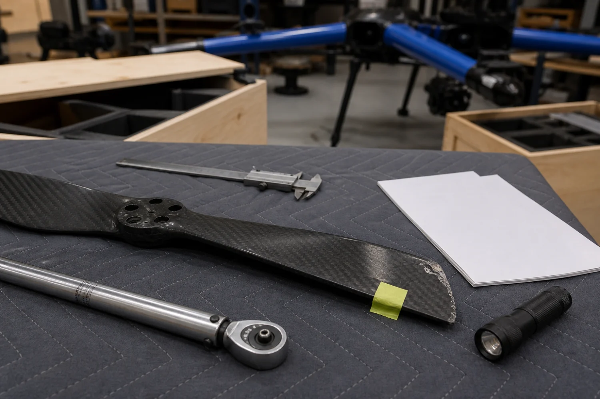
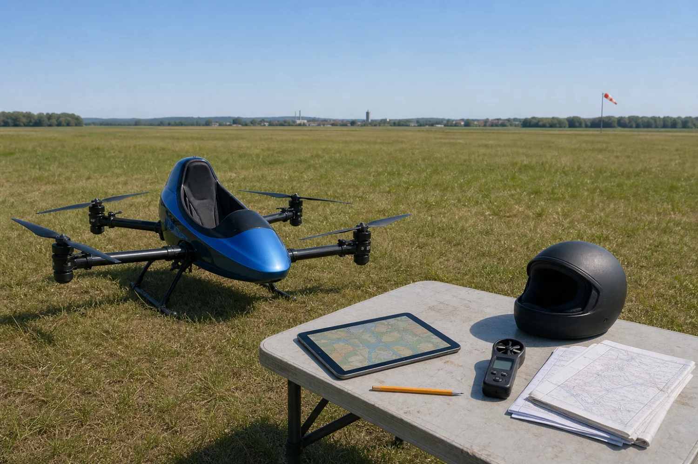

# That Temu drone flew. What did the video actually prove?

Status: separate unsaved example draft; no CMS import, replacement, save, schedule, or publication. Requires the private-reflection feature before preview/import. The original Temu article and SEO refresh remain untouched.

## Reader promise

Distinguish an impressive demonstration from broader confidence, then identify what evidence would change your view.

## Engagement plan

One primary interaction: choose → reveal authored reasoning → reconsider. No public totals, account, points, or answer collection. No added comment solicitation. Readers can skip choosing.

## Rich media map

Original source video, one private reflection, two existing disclosed editorial illustrations, and a save-worthy evidence checklist. The cinema placement comes from separate video-first PR #369; the post also works with the existing inline video renderer.

## Editorial review and measurement

The hook is the difference between an impressive event and earned confidence. The evidence and checklist remain readable without participating. The reflection has no score, invented totals, pressure to agree, or generic comment solicitation. The verdict is explicit, and the source/experience boundary remains separate from Colin’s proposed perspective.

If published later, compare existing article completion, 75% progress, saves, and return reading over consistent 7-day and 28-day windows, with raw counts and traffic context. This draft does not claim an engagement lift. Private choices are deliberately not collected as analytics.

## Draft

A flying machine leaving the ground is a powerful argument. It is also a very short one. The interesting part of Goonzquad’s full-size Temu drone story is how quickly “it moved” can turn into “I would trust it.” Those are different conclusions, and the gap between them is where I want to spend a little time.

This is commentary on <a href="https://www.youtube.com/watch?v=bUkvDe0x47A">Goonzquad’s original video, We Bought Temu’s Craziest Product!!!</a>. I did not buy, inspect, assemble, or fly their aircraft. Watch the source for the sequence of events; the questions below are about how we judge a demonstration, not instructions for operating an aircraft.

[Watch Goonzquad’s original video](https://www.youtube.com/watch?v=bUkvDe0x47A)

## What makes a demonstration convincing?

Think of a gadget video you have watched recently. It does the impressive thing, the creator looks delighted, and for a moment the purchase feels almost sensible. What did you actually learn in that moment? Pick the evidence that would matter most to you. You can read the reasoning without choosing, and the article continues either way.

[Private reflection]
Which part would do the most to earn your confidence?
- Seeing it complete the impressive demonstration
- Seeing the same result across repeated tests
- Understanding what happens when something goes wrong

Evidence to reveal: A demonstration can establish that a particular event happened under the conditions shown. Repeated tests address a different question: how consistently the result occurs. Evidence about failures addresses another: what happens outside the successful example. These are different kinds of evidence, not a scorecard for the reader. A changed answer is useful if you can explain what changed it.

## Three questions hiding inside “it works”

The first question is whether something can happen at all. That is where a convincing demonstration earns its place. A real result should make us update our expectations. Dismissing every surprising machine as impossible would be just as lazy as accepting every successful clip as a complete product review.

The second question is whether the result is repeatable. How many attempts are represented? What conditions were held steady? What changed between attempts? Those questions do not erase a successful demonstration. They tell me how far I can carry the conclusion beyond that demonstration.

Even measurements can behave differently over minutes and across days. <a href="https://www.itl.nist.gov/div898/handbook/mpc/section1/mpc114.htm">NIST’s guide to variability</a> separates short-term precision from longer-term changes in conditions. That is one reason I would want to know whether an impressive result survives beyond a carefully selected moment.

AI-generated editorial illustration of a damaged-parts inspection. It is not a photograph of the Goonzquad aircraft, its shipment, or the propeller shown in the video.

The third question is what the successful example leaves out. I want to know where the limits are, what the operator had to understand, and what evidence exists about things going wrong. Missing information is not proof of a defect. It is a reason to keep a conclusion narrower than my enthusiasm.

## Curiosity and confidence can move at different speeds

I like strange machines. The possibility that something awkward and oversized might become useful is part of the appeal. I do not want to sand that curiosity out of the story. I do want to notice when excitement starts doing the work that evidence should be doing.

<a href="https://www.nasa.gov/aeronautics/technology-readiness-levels-demystified/">NASA’s explanation of technology readiness</a> separates research, prototyping, integration, and real-world testing. I am not assigning this aircraft a rating. The useful idea is that completing one stage does not make every later stage complete.

My curiosity can go up after one clip while my confidence in everyday use barely moves. There is no contradiction there. “I want to see what happens next” is a perfectly good response. It does not need to become “I know enough to make the same decision.”

The same habit is useful when a product disappoints. One failure is an event too. It deserves attention, but it does not automatically establish how every unit behaves. The useful question is what the example helps us understand and what additional evidence would change that understanding.

AI-generated editorial illustration of planning beside a generic multicopter. It is not the Goonzquad aircraft, a documented test, or an assessment of its safety or legal status.

## A small checklist for the next impressive video

- Name the exact event the footage establishes.
- Separate what is visible from what the creator says or you infer.
- Ask which conditions and unsuccessful attempts are missing.
- Decide what additional evidence would change your view.
- Keep the conclusion as narrow as the evidence.

This is a way to read a video more carefully. It is not a substitute for qualified inspection, testing, training, or other decisions a real aircraft would require. A checklist about evidence should not pretend to become an aircraft checklist merely because a drone is in the picture.

## My take

Keep the excitement. Make the conclusion earn its size. A surprising demonstration can be worth sharing without becoming a recommendation, and a question can remain open without making the story less interesting. That is the distinction I would want a reader to carry into the next gadget video.

Return to your first choice above. Would you still choose it? If your answer changed, name the detail that changed it. If it did not, decide what evidence would. Either way, you have done something more useful than simply agreeing that the clip was wild.

## Sources and media

See source-ledger.md. This is a fresh example draft, not a verified update to the live record.
